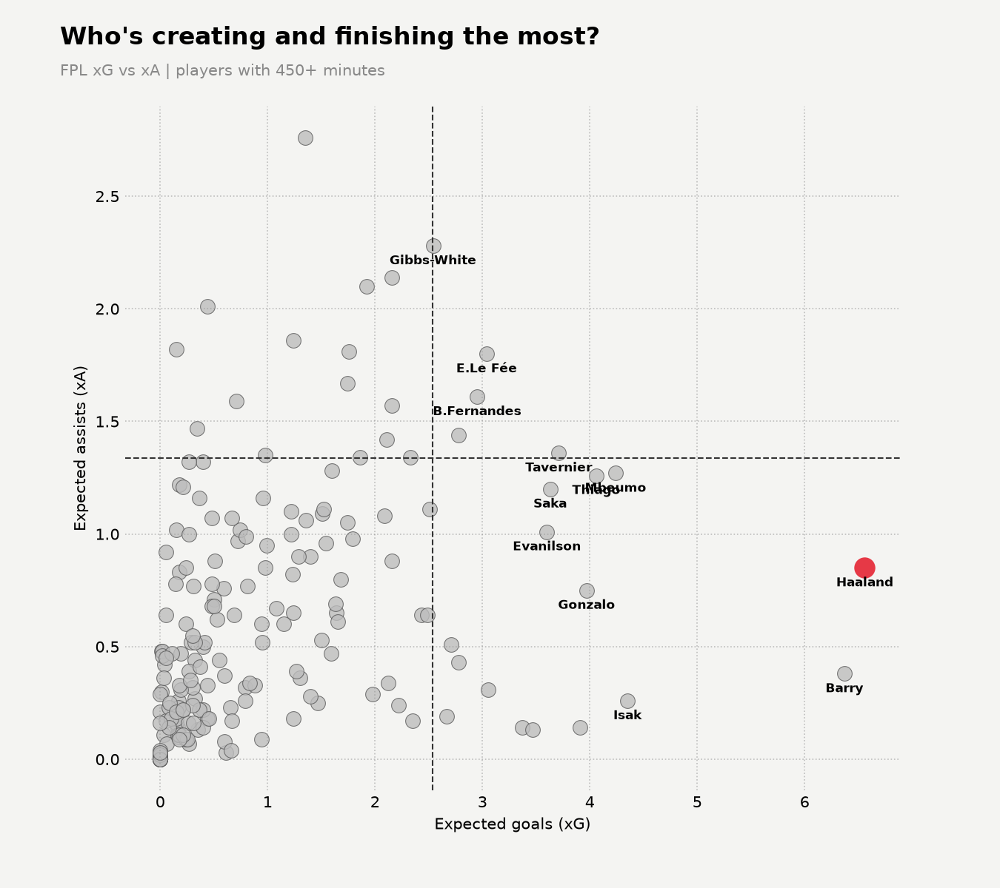

# FPL Analytics


Automated Fantasy Premier League analytics. Every week, a GitHub Actions
workflow fetches fresh player data from the FPL API, generates charts with
Python, and publishes them to a live site.

**Live site:** https://sidneytellman.github.io/fpl-analytics/



## How it works

```
FPL API → fetch.py → data/*.csv → charts.py → docs/*.png → GitHub Pages
                 ↑
     GitHub Actions (every Tuesday 06:00 UTC)
```

1. `src/fetch.py` pulls all player data from the FPL API and saves a dated CSV.
2. `src/charts.py` loads the latest CSV and builds the charts.
3. `src/main.py` runs both steps in order.
4. `.github/workflows/weekly.yml` runs the pipeline on a schedule and commits
   the new data and charts back to the repo.
5. GitHub Pages serves the `docs/` folder as the public site.

## Charts

- **Who's creating and finishing the most?** Expected goals (xG) vs expected assists (xA).
- **Best value in FPL right now.** Total points vs price, highlighting points per million.

## Run it locally

```
pip install -r requirements.txt
python src/main.py
```

Charts are saved to `docs/`.

## Tech

Python · pandas · matplotlib · requests · GitHub Actions · GitHub Pages
